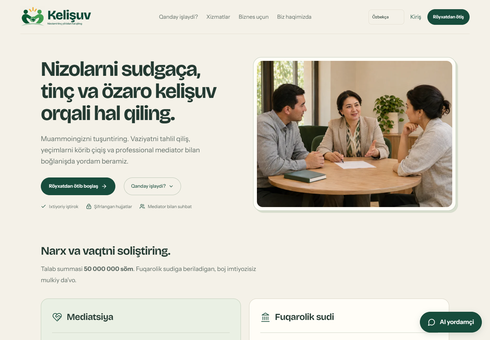
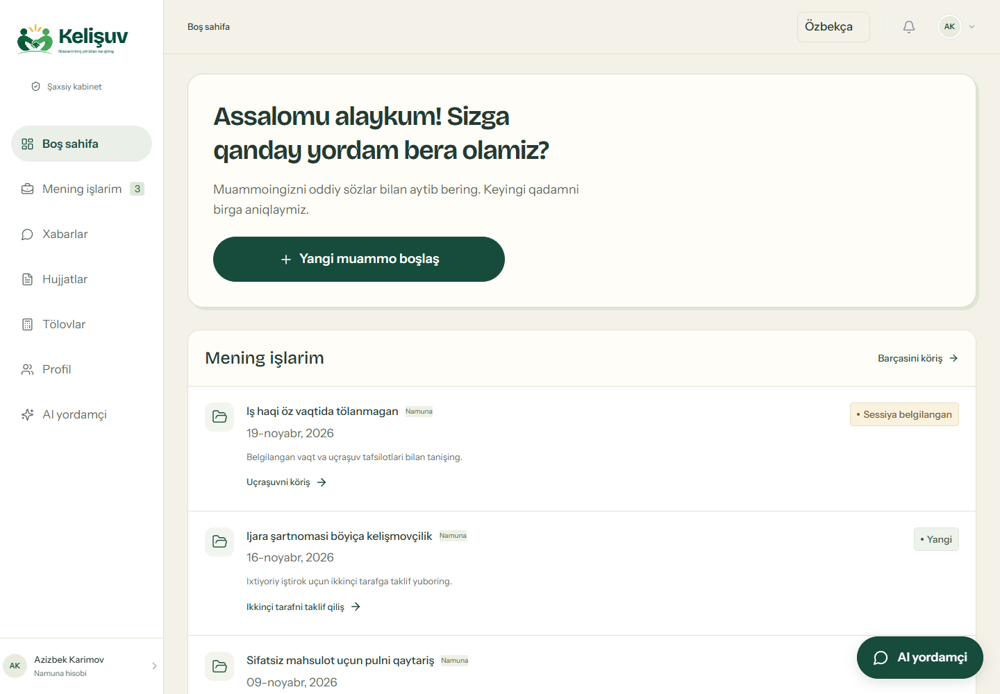
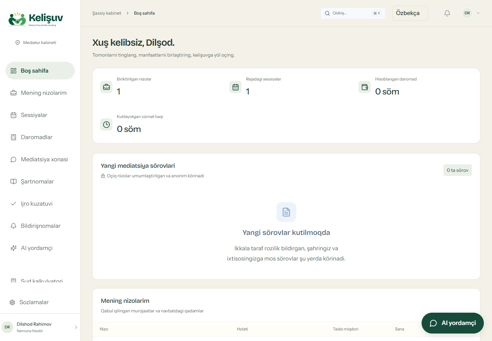
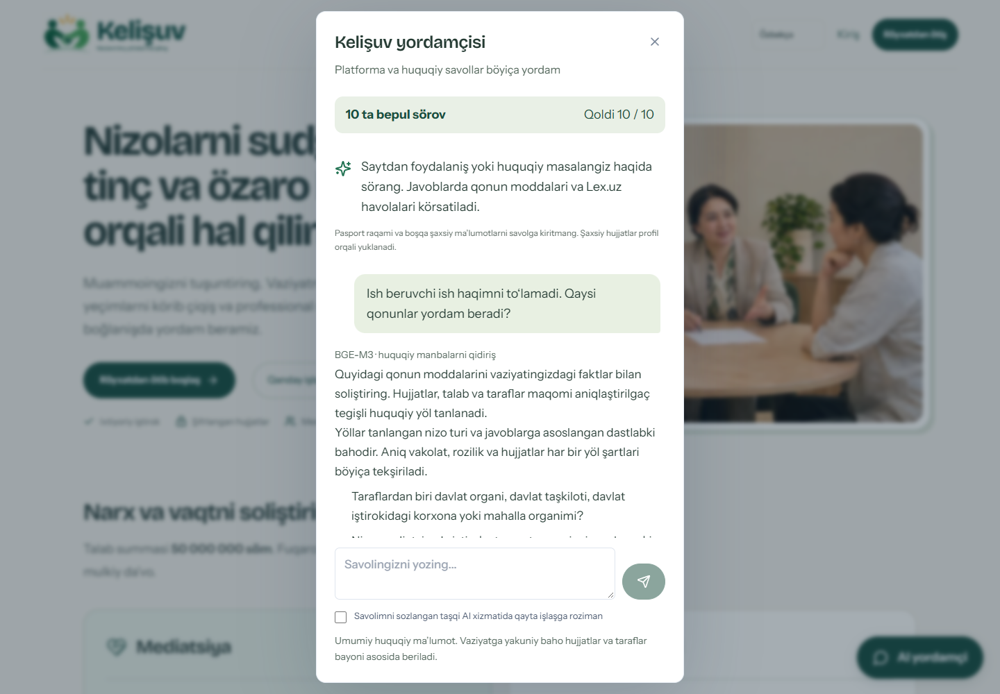
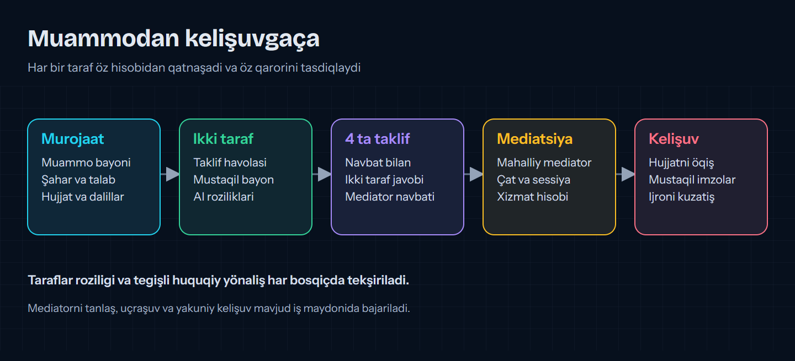
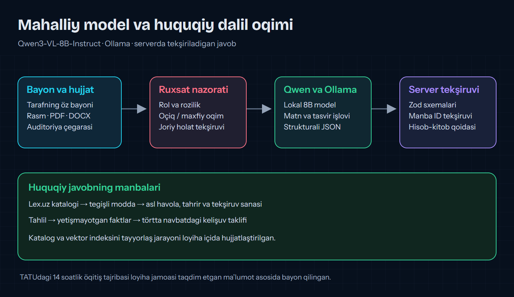
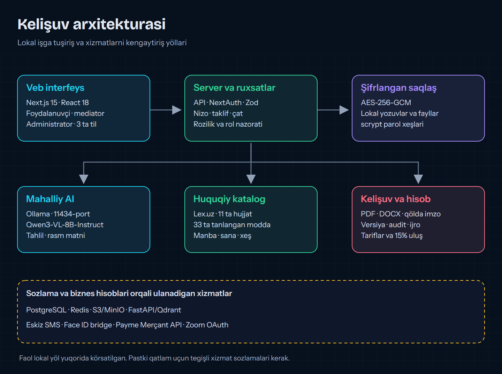
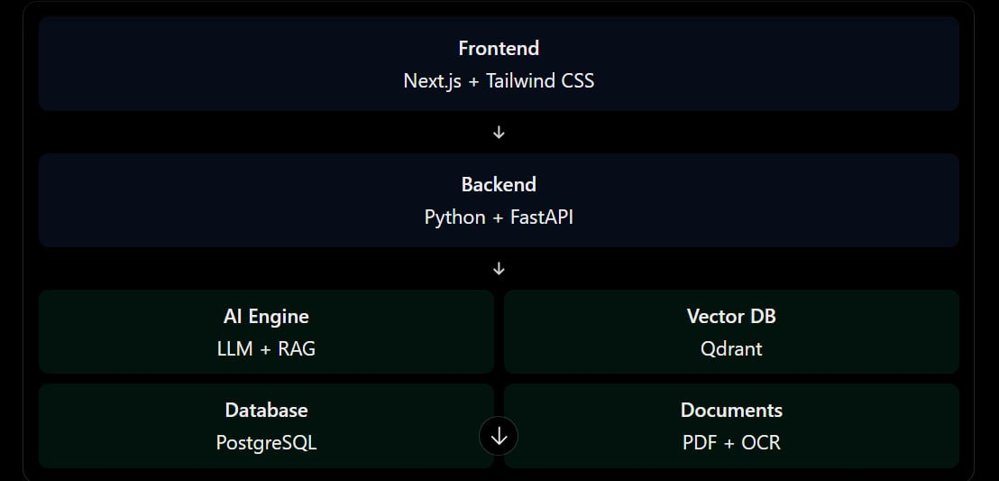
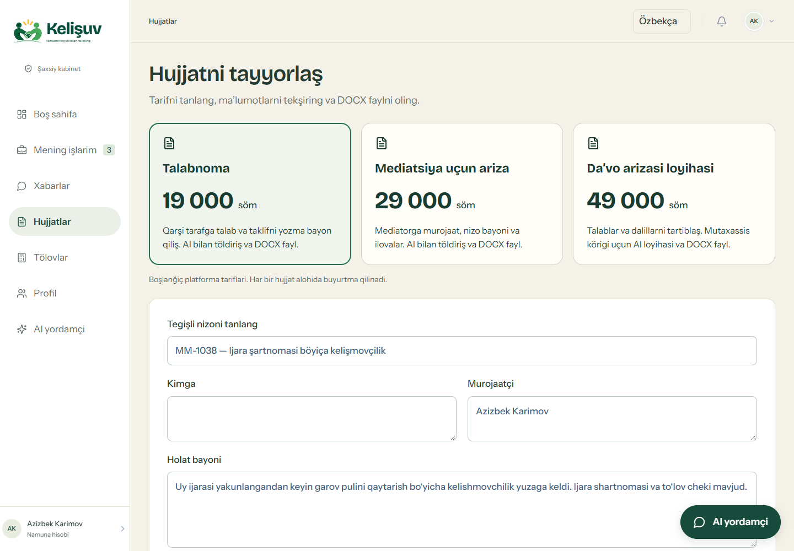

# KELIŞUV AI LAWAAA AI TEAM


Özbekiston uçun mahalliy mediatsiya va nizolarni hal qiliş platformasi. Ilova `http://localhost:2345` manzilida işlaydi.



[Ommaviy taqdimot](https://github.com/Albeerte/kelishuv-ai-showcase) · [Rasmli PDF](output/pdf/Kelishuv-platforma.pdf) · [Vaqtinçalik namoyiş](https://armadillo-writing-sanctuary.ngrok-free.dev/welcome)

Muallif va loyiha egasi Abduxoliq Solijonov. Manba kodi private repozitoriyda saqlanadi. Public taqdimotda interfeys rasmlari, tizim arxitekturasi, lokal model va loyiha haqida ma’lumot berilgan. Namoyiş havolasi kompyuter va tunnel işlayotgan paytda faol.

## LexHackathon 2026 taqdimoti

[3 daqiqalik PowerPoint](docs/presentation/Kelishuv-LexHackathon-2026.pptx) · [PDF körinişi](docs/presentation/Kelishuv-LexHackathon-2026.pdf) · [Biznes modeli va manbalar](docs/PITCH_EVIDENCE.md)

Taqdimot şablondagi sakkiz mavzuni qamraydi. Nutq matni PowerPoint izohlarida 180 soniyaga taqsimlangan. Muammo bayoni loyiha egasining qariyb 10 mediator bilan dastlabki suhbatlari, bozor dalillari esa Oliy sud va Adliya vazirligi manbalariga tayangan. Taqdim etilgan xakaton qoidalarida final uçun 3 daqiqa nutq, 2 daqiqa demo va 2 daqiqa savol-javob belgilangan.

Bozor ssenariylari, namunaviy gonorar, xarajat va pilot hajmlari tekşiriladigan faraz yoki maqsad sifatida berilgan. Boşlanğiç model mediator belgilaydigan narx va 15% platforma uluşiga asoslanadi.

## Interfeys

Özbekça interfeys va loyiha materiallari foydalanuvçi yuborgan harflar namunasiga mos yoziladi. `G‘/g‘ → Ğ/ğ`, `O‘/o‘ → Ö/ö`, `Sh/sh → Ş/ş` va `Ch/ch → Ç/ç` almaştirişlari menyu, xabar, logo, AI javobi va taqdimotlarda qöllanadi. Qidiruv har ikkala yozuvdagi sörovlarni qabul qiladi.

Kabinetda asosiy amal “Yangi muammo boşlaş” tugmasidir. Yirik matn, yaşil brend, iliq fon va bosqiçli jarayon foydalanuvçiga keyingi qadamni körsatadi. Ekran rasmlari ilovaning haqiqiy interfeysidan, namunaviy ma’lumotlar bilan olingan.

| Foydalanuvçi | Mediator |
| --- | --- |
|  |  |

| Administrator | Huquqiy yordamçi |
| --- | --- |
|  |  |



## Işga tuşiriş

Node.js 24.19 va Python 3.14 bilan tekşirildi. Frontend, API, hujjat yaratiş va şifrlangan saqlaş Node jarayonida işlaydi.

```powershell
npm install
npx prisma generate
Copy-Item .env.example .env.local
npm run build
npm start
```

Işlab çiqiş uçun `npm run dev` işlatiladi. Ikkala server buyruği `127.0.0.1:2345` ga boğlanadi. `.env.local` içidagi `LOCAL_DEMO=true` namuna hisoblarini yoqadi.

- [Taqdimot sahifasi](http://localhost:2345/welcome)
- [Foydalanuvçi kabineti](http://localhost:2345/)
- [Röyxatdan ötiş](http://localhost:2345/auth/register)
- [Mediatorlar](http://localhost:2345/mediators)

Sozlamalarda fuqaro, ikkinçi taraf, mediator va administrator namuna hisoblari mavjud. Şaxsiy röyxatdan ötgan foydalanuvçi öz hisobiga kiradi. Mediator arizasi administrator tomonidan tekşiriladi. Taşkilot va bank hisoblari qöllanadi.

## Işlaydigan MVP

1. Foydalanuvçi nizo, şahar, talab summasi va dalillarini kiritadi.
2. Ikkinçi taraf telefon yoki emailga boğlangan şaxsiy taklif orqali mos hisobidan qöşiladi. Havola töliq manzil bilan yaratiladi va sahifa yangilanganda qayta tiklanadi.
3. Har bir taraf oçiq va maxfiy bayonini, mahalliy va taşqi AI roziligini mustaqil saqlaydi.
4. Iş maydonidagi AI tahlili oçiq bayon va ulaşilgan dalillardan tayyorlanadi. Yangi murojaatda törtta taklif navbat bilan körsatiladi, har bosqiçda ikki tarafning mustaqil javobi qayd etiladi.
5. Ikki taraf yönaltirişga rozilik bergaç, şahar va yönalişiga mos mediator nizoni navbatda köradi. Mediator qabul qiladi, qönğiroq qaydini va iş rejasini tuzadi. Ikkala taraf mediatorni tasdiqlaydi.
6. Mediator yozma tartib-taomil kelişuvini tayyorlaydi. Birinçi taraf, ikkinçi taraf va mediator navbat bilan imzolaydi.
7. Sessiya belgilanadi. Umumiy va mediator bilan maxfiy xabarlar mavjud. Kalendar uçun ICS yuklanadi.
8. Mediator yakuniy kelişuv, rekvizitlar, jadval va majburiyatlarni tayyorlaydi. Uç iştirokçi PDFni körib, mustaqil imzolaydi.
9. Imzolar PDF va DOCX içiga joylaştiriladi. Server nusxa, mazmun xeşi, fayl xeşi, vaqt va auditni saqlaydi. Tahrir yangi imzolaş jarayonini oçadi.
10. Ijro sahifasi kelişilgan summa, qabul qiluvçi tasdiqlagan tölov, qoldiq, muddat va bajariş tarixini körsatadi. Tölovçi hisobot beradi, oluvçi uni tasdiqlaydi yoki qaytaradi.
11. Telefon bilan röyxatdan ötiş, şifrlangan pasport yuklaş, AI orqali maydon taklifi va Face ID provayderiga ulaniş jarayoni mavjud.
12. Hujjat studiyasi tarif, şaxsiy qoralama, tasdiqlangan tölovdan keyingi AI töldiriş va DOCX yuklaşni birlaştiradi. Har sahifadagi yordamçi sayt yöriqnomasi va Lex.uz manbalarini körsatadi.
13. Kabinetdagi AI yordamçida har hisob uçun jami 10 ta bepul sörov mavjud. RAG 25 hujjatdagi 7 368 moddani Orama BM25 va lokal BGE-M3 bilan qidiradi. Tanlangan moddalar Lex.uz dan tekşiriladi, javob Qwen bilan yaratiladi. Oliy sudning oçiq materiallari va Plenum qarorlari qöşimça manba böladi. [Manbalar, litsenziyalar va qamrov](docs/ASSISTANT_DATA_SOURCES.md)
14. Taraf murojaatini qaytarib olişi yoki mustaqil kelişuv sababli yopişni söraşi mumkin. Ikkinçi holatda qöşilgan qarşi taraf ham tasdiqlaydi. Tarix va hujjatlar saqlanadi.

Özbek lotin, özbek kirill va rus tillari tanlanadi. Mobil menyu, PDF kattalaştiriş, sensor imzo, undo, clear, preview, imzo joylarini suriş va ölçamini kiritiş mavjud. Avvalgi nizolar va hujjatlar bilan moslik saqlangan.

## Mahalliy AI

Uşbu kompyuterda mavjud Ollama va `qwen3-vl:8b-instruct` tanlandi. Provayder holati ilovada körinadi. Qwen bilan oçiq tahlil, alohida maxfiy tahlil, rasm va skan PDF ekstraksiyasi haqiqiy lokal sörovlar orqali tekşirildi.

```dotenv
AI_PROVIDER=OLLAMA
OLLAMA_BASE_URL=http://127.0.0.1:11434
AI_MODEL=qwen3-vl:8b-instruct
AI_EMBEDDING_MODEL=bge-m3
```

`ollama list` orqali uşbu muhitda model mavjudligi qayta tekşirildi. Model adapteri matn va tasvirlarni qabul qiladi, strukturali javob serverda Zod bilan tekşiriladi. Asosiy foydalaniş yöllari bayon tahlili, yetişmayotgan faktlarni aniqlaş va hujjatdan ma’lumot ajratişdir. [Qwen rasmiy model kartasi](https://huggingface.co/Qwen/Qwen3-VL-8B-Instruct), [Ollama çat API](https://docs.ollama.com/api/chat)



### TATU serveridagi 14 soatlik öqitiş tajribasi

Loyiha jamoasi taqdim etgan ma’lumotga köra, TATU serverida Lex.uz va boşqa huquqiy saytlardan tayyorlangan ma’lumotlar asosida **14 soatlik model öqitiş tajribasi** ötkazilgan. Uşbu tavsifdagi server, davomiylik va öqitiş manbalari loyiha egasining ma’lumotiga tayangan.

Repozitoriydagi amaldagi işga tuşiriş konfiguratsiyasi Ollama orqali `qwen3-vl:8b-instruct` modeliga ulanadi. TATU tajribasining usuli, server apparati va yakuniy çeckpointi haqidagi texnik ma’lumotlar loyiha jamoasi tomonidan taqdim etiladi.

`RULES` rejimi taşqi model çaqiriğisiz qoidaviy yordam beradi. `OPENAI_COMPATIBLE`, `AI_BASE_URL`, `AI_MODEL` va `AI_API_KEY` boşqa mos servisni ulaşga xizmat qiladi. Masofadagi servis HTTPS va tegişli taraflarning taşqi işlov roziligini talab qiladi. Har bir uzatiş oldidan joriy ruxsat tekşiriladi. Rozilik nizo yakunlangaç ham qaytarib olinadi.

Takliflarning jadvali va arifmetikasi server qoidalarida tuziladi. Mahalliy model faktlar, kamçiliklar va qarama-qarşiliklar tahlilini beradi. Sintetik sinovlar özbek huquqiy aniqligi böyiça keng bençmark örnini bosmaydi. Huquqiy baho va hujjatni yakunlaş mediator körigidan ötadi.

PDF matni dastlabki 15 sahifadan olinadi. Skan OCR dastlabki ikki sahifani işlaydi. DOCX xom matni va TXT ham qöllanadi. Ajratilgan ma’lumot tekşirilmagan deb belgilanadi.

## Arxitektura va ma’lumotlar



[Arxitekturaning lokal oçiladigan varianti](docs/media/architecture.html)

### FastAPI va Qdrant bilan kengaytiriş varianti



Sxema ixtiyoriy FastAPI/Qdrant yölini tasvirlaydi. Joriy MVPning asosiy API va saqlaş jarayoni Next.js serverida, model sörovlari Ollama orqali işlaydi. PostgreSQL, FastAPI/Qdrant va OCR qatlamlari tegişli konfiguratsiya hamda servislar bilan ulanadi.

Next.js 15.5.29, React 18.3, TypeScript, Tailwind, Radix, Zustand, NextAuth va Prisma mavjud asos sifatida kengaytirildi. Asosiy API `src/app/api/[...path]/route.ts`, yangi oqim `src/lib/kelishuv-api.ts` içida joylaşgan. AI, dalil ekstraksiyasi, PDF/DOCX va ijro alohida modullardir.

Yozuvlar `.data/medimatch.enc`, hujjatlar `.data/documents/` içida AES-256-GCM bilan şifrlanadi. Kalit `.data/encryption.key` yoki `DATA_ENCRYPTION_KEY` orqali olinadi. Zaxirada kalit va ma’lumot birga saqlanişi kerak. Parollar noyob salt bilan scrypt orqali xeşlanadi. `.data/` va mahalliy muhit fayllari Gitdan çiqarilgan.

Mahalliy fayl ombori bitta ilova jarayoniga möljallangan. `DATABASE_URL` sozlanganda şifrlangan snapşot PostgreSQLda saqlanadi. Mutatsiyalar tranzaksiya va advisory lock bilan ketma-ket bajariladi.

```powershell
npx prisma db push
```

`LOCAL_DEMO=false` yangi ma’lumotlar bazasida şaxsiy röyxatdan ötişni oçadi. Boşlanğiç administrator uçun birinçi işga tuşirişdan oldin `INITIAL_ADMIN_EMAIL` va kamida 12 belgili `INITIAL_ADMIN_PASSWORD` beriladi. Boşlanğiç sozlaşdan söng uşbu bootstrap özgaruvçilari olib taşlanadi.

## Lex.uz va ixtiyoriy xizmatlar

Mediator iş maydonidagi yönaltiriş katalogida 11 rasmiy hujjatdan 33 tanlangan modda, aniq havola, tahrir sanasi va xeş bor. Umumiy AI yordamçi 25 hujjatdagi 7 368 moddali korpus, lokal BGE-M3 va Lex.uz jonli qidiruvidan foydalanadi. Korpus `npm run assistant:sync` orqali yangilanadi, keyin ilova qayta yiğiladi.

```powershell
python scripts/index_laws.py --as-of 2026-11-20
```

Ixtiyoriy FastAPI/Qdrant RAG xizmati avvalgi huquqiy çat uçun saqlangan.

```powershell
python -m venv .venv
.venv\Scripts\python -m pip install -r ai_service\requirements.txt
.venv\Scripts\python -m uvicorn ai_service.main:app --host 127.0.0.1 --port 8000
```

`FASTAPI_URL`, `AI_SERVICE_KEY`, `QDRANT_URL` va tegişli embedding kaliti sozlanadi. `--cached --embed` katalogni Qdrantga indekslaydi. Çunk, manba xeşi va atomik indeks almaştiriş [Lex.uz pipeline](docs/LEX_UZ_PIPELINE.md) hujjatida bayon qilingan.

`REDIS_URL` umumiy rate limit uçun, MinIO/S3 özgaruvçilari şifrlangan obyekt ombori uçun, SMTP özgaruvçilari email outbox uçun işlatiladi. Töliq röyxat `.env.example` içida. Mahalliy bildirişnomalar va 60 soniyali ijro eslatmalari ilova içida işlaydi. Bir kunlik bir xil eslatma qayta yaratilmaydi.

Docker Compose Next.js, FastAPI, PostgreSQL, Qdrant, Redis, MinIO va Nginx variantini beradi. `POSTGRES_PASSWORD` va tegişli kalitlarni berib, `docker compose up --build` bilan işga tuşiriladi. 2345-portni oldingi serverdan böşatiş kerak. Docker varianti uşbu tekşiruvda işga tuşirilmadi.

## Integratsiya va huquqiy holat

Qölda çizilgan imzo vizual yozuv, hisob autentifikatsiyasi, rozilik, vaqt va audit bilan saqlanadi. ERI va OneID ulanişlari sozlanmagan. Mediatorning rasmiy reyestri administrator tomonidan qölda tekşiriladi. Namuna profillarida `DEMO DATA` körinadi.

Hujjatlar uçun boşlanğiç tariflar talabnoma uçun 19 000, mediatsiya arizasi uçun 29 000 va da’vo loyihasi uçun 49 000 söm qilib belgilangan. Mediator xizmati kelişilgan hisob asosida ikki tarafga teng taqsimlanadi. Platforma uluşi 15 foiz. Summalar va tölov huquqlari serverda tekşiriladi.

Eskiz SMS, normallaştirilgan Face ID bridge, Payme Merçant API va Zoom Server-to-Server OAuth adapterlari mavjud. Ularning biznes hisoblari va kalitlari sozlanişini kutmoqda. Face ID provayderining SDK va autentifikatsiyasi bridge bilan moslaştiriladi. Mediatorga bank payout qiliş uçun biznes hisob-kitob sozlamalari kerak. Mavjud sessiya oqimida Jitsi havolasi ham qöllanadi. Ulaniş şartnomalari [kengaytma rejasida](docs/KELISHUV_EXPANSION_PLAN.md) berilgan.



Saqlaş muddati, eksport va öçiriş sörovi Sozlamalardan administratorga yuboriladi. Huquqiy saqlaş va öçiriş siyosati taşkilotning hujjat turlari hamda majburiyatlari asosida belgilanadi. Har bir yangi yakuniy hujjat nusxasi yangi ijro rejasini yaratadi. Oldingi nusxa hisobotlari alohida tarixda körinadi va mediator yangi jadvalni şu tarix bilan soliştiradi.

Ovozli kiritiş, keng huquqiy model baholaşi, murakkab OCR va enterprise integratsiyalar keyingi fazalarga kiritilgan.

## Tekşiruv

```powershell
npm run lint
npm run typecheck
npm test
npm run build
npm audit
```

Saqlangan 66 ta regressiya testi maxfiylik, AI dispatç ruxsati, audit, hujjat çegaralari, tölov qayta urinişlari, şaxsni tekşiriş callbacklari, SMS yuboriş, Zoom tiklaş, takliflar, RAG manbalari, raqamli da’volar, bepul limit, nizoni yopiş va yangi harflar bilan qidiruvni qamraydi. Ngrok orqali ikki tarafli taklif va yopiş jarayoni, haqiqiy lokal RAG javobi hamda 10 ta sörov limiti tekşirildi. Uçta yangi avtomatik WCAG auditida xato qaytmadi. `npm run test:design` töqqizta ekstraktor regressiyasini tekşiradi. API va brauzer natijalari [VERIFICATION.md](docs/VERIFICATION.md) hujjatida qayd etilgan.

## Tadqiqot va reja

- [Oçiq kod tanlovlari](OPEN_SOURCE_RESEARCH.md)
- [Model taqqoslaşi](docs/MODEL_COMPARISON.md)
- [Huquqiy imzolaş tadqiqoti](docs/SIGNING_LEGAL.md)
- [Imzo arxitekturasi](docs/SIGNATURE_IMPLEMENTATION.md)
- [Amalga oşiriş rejasi](docs/KELISHUV_PLAN.md)
- [Sud va mediatsiyaga yönaltiriş](docs/LEGAL_ROUTING.md)
- [Interfeys yangilanişi va tekşiruvlar](docs/REDESIGN_PLAN.md)

## Yangilangan interfeys

Ommaviy taqdimot `/welcome`, şaxsiy kabinet `/`, ikki qadamli röyxatdan ötiş `/auth/register`, beş qadamli murojaat `/dashboard/new` manzillarida işlaydi. Mediator `/mediator`, administrator `/admin` bölimidan foydalanadi.

Qoralama şu brauzer sessiyasida har bir hisob uçun alohida saqlanadi. Tiklaşda fayllar qayta tanlanadi. Murojaat yuborilgaç aloqa uzilsa, qayta uriniş saqlangan işni tiklaydi. Taklif yaratişdagi xato saqlangan işga boğlangan qayta uriniş orqali davom ettiriladi.

## Dizayn manbasini yiğiş

Getsherik’ning oçiq HTML manbasi lokal Çromium’da render qilinib, ranglari, şriftlari, DOM, computed CSS, scroll va hover holatlari ölçandi. Kelişuv’da şu tipografika va iliq yuzalar yaşil brend bilan moslaştirildi. Şrift fayllari lokal saqlanadi.

```powershell
npm run design:reference -- https://getsherik.uz/ --public-proxy
npm run design:reference -- http://127.0.0.1:2345/welcome
```

Natijalar `.data/design-reference/` içida yangi papkaga yoziladi. `DESIGN.md`, `design.json`, `tokens.css`, `preview.html`, resurslar va törtta ekran ölçamidagi screenşotlar yaratiladi. Birinçi işga tuşiriş Git orqali extractor manbasini va alohida Playwright runtime’ini tayyorlaydi. Node.js 24.19 bilan tekşirildi.

`--public-proxy` oçiq URL uçun IntelliScrape hosted xizmatini yoqadi. Getsherik’dagi töğridan-töğri HTTPS sertifikat xatosi sabab bu parametr işlatildi. Kabinet tahlili ommaviy frontend manbasiga asoslangan. Batafsil ölçovlar, yuklangan vositalar va qayta işga tuşiriş parametrlari [dizayn hujjatida](docs/DESIGN.md) berilgan.

Ekstraktorning HTTP xatolari, keç yuklangan fayllar, takroriy URL, nisbiy CSS havolalari, xato navigatsiya, parallel yoziş va dastlabki örnatiş holatlari `npm run test:design` orqali tekşiriladi.
