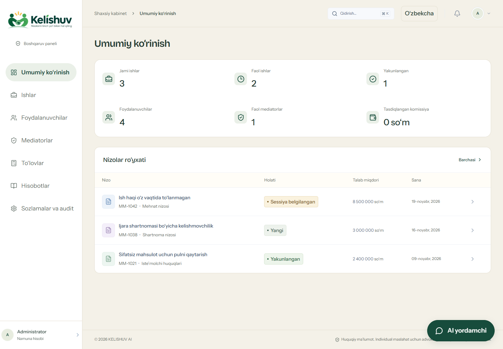

# KELISHUV AI LAWAAA AI TEAM


O‘zbekiston uchun mahalliy mediatsiya va nizolarni hal qilish platformasi. Ilova `http://localhost:2345` manzilida ishlaydi.


[Ommaviy taqdimot](https://github.com/Albeerte/kelishuv-ai-showcase) · [Rasmli PDF](output/pdf/Kelishuv-platforma.pdf) · [Vaqtinchalik namoyish](https://armadillo-writing-sanctuary.ngrok-free.dev/welcome)

Muallif va loyiha egasi Abduxoliq Solijonov. Manba kodi private repozitoriyda saqlanadi. Public taqdimotda interfeys rasmlari, tizim arxitekturasi, lokal model va loyiha haqida ma’lumot berilgan. Namoyish havolasi kompyuter va tunnel ishlayotgan paytda faol.

## Interfeys

Kabinetda asosiy amal “Yangi muammo boshlash” tugmasidir. Yirik matn, yashil brend, iliq fon va bosqichli jarayon foydalanuvchiga keyingi qadamni ko‘rsatadi. Ekran rasmlari ilovaning haqiqiy interfeysidan, namunaviy ma’lumotlar bilan olingan.

| Foydalanuvchi | Mediator |
| --- | --- |
|  |  |

| Administrator | Huquqiy yordamchi |
| --- | --- |
|  |  |


## Ishga tushirish

Node.js 24.19 va Python 3.14 bilan tekshirildi. Frontend, API, hujjat yaratish va shifrlangan saqlash Node jarayonida ishlaydi.

```powershell
npm install
npx prisma generate
Copy-Item .env.example .env.local
npm run build
npm start
```

Ishlab chiqish uchun `npm run dev` ishlatiladi. Ikkala server buyrug‘i `127.0.0.1:2345` ga bog‘lanadi. `.env.local` ichidagi `LOCAL_DEMO=true` namuna hisoblarini yoqadi.

- [Taqdimot sahifasi](http://localhost:2345/welcome)
- [Foydalanuvchi kabineti](http://localhost:2345/)
- [Ro‘yxatdan o‘tish](http://localhost:2345/auth/register)
- [Mediatorlar](http://localhost:2345/mediators)

Sozlamalarda fuqaro, ikkinchi taraf, mediator va administrator namuna hisoblari mavjud. Shaxsiy ro‘yxatdan o‘tgan foydalanuvchi o‘z hisobiga kiradi. Mediator arizasi administrator tomonidan tekshiriladi. Tashkilot va bank hisoblari qo‘llanadi.

## Ishlaydigan MVP

1. Foydalanuvchi nizo, shahar, talab summasi va dalillarini kiritadi.
2. Ikkinchi taraf telefon yoki emailga bog‘langan shaxsiy taklif orqali mos hisobidan qo‘shiladi. Havola to‘liq manzil bilan yaratiladi va sahifa yangilanganda qayta tiklanadi.
3. Har bir taraf ochiq va maxfiy bayonini, mahalliy va tashqi AI roziligini mustaqil saqlaydi.
4. Ish maydonidagi AI tahlili ochiq bayon va ulashilgan dalillardan tayyorlanadi. Yangi murojaatda to‘rtta taklif navbat bilan ko‘rsatiladi, har bosqichda ikki tarafning mustaqil javobi qayd etiladi.
5. Ikki taraf yo‘naltirishga rozilik bergach, shahar va yo‘nalishiga mos mediator nizoni navbatda ko‘radi. Mediator qabul qiladi, qo‘ng‘iroq qaydini va ish rejasini tuzadi. Ikkala taraf mediatorni tasdiqlaydi.
6. Mediator yozma tartib-taomil kelishuvini tayyorlaydi. Birinchi taraf, ikkinchi taraf va mediator navbat bilan imzolaydi.
7. Sessiya belgilanadi. Umumiy va mediator bilan maxfiy xabarlar mavjud. Kalendar uchun ICS yuklanadi.
8. Mediator yakuniy kelishuv, rekvizitlar, jadval va majburiyatlarni tayyorlaydi. Uch ishtirokchi PDFni ko‘rib, mustaqil imzolaydi.
9. Imzolar PDF va DOCX ichiga joylashtiriladi. Server nusxa, mazmun xeshi, fayl xeshi, vaqt va auditni saqlaydi. Tahrir yangi imzolash jarayonini ochadi.
10. Ijro sahifasi kelishilgan summa, qabul qiluvchi tasdiqlagan to‘lov, qoldiq, muddat va bajarish tarixini ko‘rsatadi. To‘lovchi hisobot beradi, oluvchi uni tasdiqlaydi yoki qaytaradi.
11. Telefon bilan ro‘yxatdan o‘tish, shifrlangan pasport yuklash, AI orqali maydon taklifi va Face ID provayderiga ulanish jarayoni mavjud.
12. Hujjat studiyasi tarif, shaxsiy qoralama, tasdiqlangan to‘lovdan keyingi AI to‘ldirish va DOCX yuklashni birlashtiradi. Har sahifadagi yordamchi sayt yo‘riqnomasi va Lex.uz manbalarini ko‘rsatadi.
13. Kabinetdagi AI yordamchida har hisob uchun jami 10 ta bepul so‘rov mavjud. RAG 25 hujjatdagi 7 368 moddani Orama BM25 va lokal BGE-M3 bilan qidiradi. Tanlangan moddalar Lex.uz dan tekshiriladi, javob Qwen bilan yaratiladi. Oliy sudning ochiq materiallari va Plenum qarorlari qo‘shimcha manba bo‘ladi. [Manbalar, litsenziyalar va qamrov](docs/ASSISTANT_DATA_SOURCES.md)
14. Taraf murojaatini qaytarib olishi yoki mustaqil kelishuv sababli yopishni so‘rashi mumkin. Ikkinchi holatda qo‘shilgan qarshi taraf ham tasdiqlaydi. Tarix va hujjatlar saqlanadi.

O‘zbek lotin, o‘zbek kirill va rus tillari tanlanadi. Mobil menyu, PDF kattalashtirish, sensor imzo, undo, clear, preview, imzo joylarini surish va o‘lchamini kiritish mavjud. Avvalgi nizolar va hujjatlar bilan moslik saqlangan.

## Mahalliy AI

Ushbu kompyuterda mavjud Ollama va `qwen3-vl:8b-instruct` tanlandi. Provayder holati ilovada ko‘rinadi. Qwen bilan ochiq tahlil, alohida maxfiy tahlil, rasm va skan PDF ekstraksiyasi haqiqiy lokal so‘rovlar orqali tekshirildi.

```dotenv
AI_PROVIDER=OLLAMA
OLLAMA_BASE_URL=http://127.0.0.1:11434
AI_MODEL=qwen3-vl:8b-instruct
AI_EMBEDDING_MODEL=bge-m3
```

`ollama list` orqali ushbu muhitda model mavjudligi qayta tekshirildi. Model adapteri matn va tasvirlarni qabul qiladi, strukturali javob serverda Zod bilan tekshiriladi. Asosiy foydalanish yo‘llari bayon tahlili, yetishmayotgan faktlarni aniqlash va hujjatdan ma’lumot ajratishdir. [Qwen rasmiy model kartasi](https://huggingface.co/Qwen/Qwen3-VL-8B-Instruct), [Ollama chat API](https://docs.ollama.com/api/chat)


### TATU serveridagi 14 soatlik o‘qitish tajribasi

Loyiha jamoasi taqdim etgan ma’lumotga ko‘ra, TATU serverida Lex.uz va boshqa huquqiy saytlardan tayyorlangan ma’lumotlar asosida **14 soatlik model o‘qitish tajribasi** o‘tkazilgan. Ushbu tavsifdagi server, davomiylik va o‘qitish manbalari loyiha egasining ma’lumotiga tayangan.

Repozitoriydagi amaldagi ishga tushirish konfiguratsiyasi Ollama orqali `qwen3-vl:8b-instruct` modeliga ulanadi. TATU tajribasining usuli, server apparati va yakuniy checkpointi haqidagi texnik ma’lumotlar loyiha jamoasi tomonidan taqdim etiladi.

`RULES` rejimi tashqi model chaqirig‘isiz qoidaviy yordam beradi. `OPENAI_COMPATIBLE`, `AI_BASE_URL`, `AI_MODEL` va `AI_API_KEY` boshqa mos servisni ulashga xizmat qiladi. Masofadagi servis HTTPS va tegishli taraflarning tashqi ishlov roziligini talab qiladi. Har bir uzatish oldidan joriy ruxsat tekshiriladi. Rozilik nizo yakunlangach ham qaytarib olinadi.

Takliflarning jadvali va arifmetikasi server qoidalarida tuziladi. Mahalliy model faktlar, kamchiliklar va qarama-qarshiliklar tahlilini beradi. Sintetik sinovlar o‘zbek huquqiy aniqligi bo‘yicha keng benchmark o‘rnini bosmaydi. Huquqiy baho va hujjatni yakunlash mediator ko‘rigidan o‘tadi.

PDF matni dastlabki 15 sahifadan olinadi. Skan OCR dastlabki ikki sahifani ishlaydi. DOCX xom matni va TXT ham qo‘llanadi. Ajratilgan ma’lumot tekshirilmagan deb belgilanadi.

## Arxitektura va ma’lumotlar


[Arxitekturaning lokal ochiladigan varianti](docs/media/architecture.html)

Next.js 15.5.29, React 18.3, TypeScript, Tailwind, Radix, Zustand, NextAuth va Prisma mavjud asos sifatida kengaytirildi. Asosiy API `src/app/api/[...path]/route.ts`, yangi oqim `src/lib/kelishuv-api.ts` ichida joylashgan. AI, dalil ekstraksiyasi, PDF/DOCX va ijro alohida modullardir.

Yozuvlar `.data/medimatch.enc`, hujjatlar `.data/documents/` ichida AES-256-GCM bilan shifrlanadi. Kalit `.data/encryption.key` yoki `DATA_ENCRYPTION_KEY` orqali olinadi. Zaxirada kalit va ma’lumot birga saqlanishi kerak. Parollar noyob salt bilan scrypt orqali xeshlanadi. `.data/` va mahalliy muhit fayllari Gitdan chiqarilgan.

Mahalliy fayl ombori bitta ilova jarayoniga mo‘ljallangan. `DATABASE_URL` sozlanganda shifrlangan snapshot PostgreSQLda saqlanadi. Mutatsiyalar tranzaksiya va advisory lock bilan ketma-ket bajariladi.

```powershell
npx prisma db push
```

`LOCAL_DEMO=false` yangi ma’lumotlar bazasida shaxsiy ro‘yxatdan o‘tishni ochadi. Boshlang‘ich administrator uchun birinchi ishga tushirishdan oldin `INITIAL_ADMIN_EMAIL` va kamida 12 belgili `INITIAL_ADMIN_PASSWORD` beriladi. Boshlang‘ich sozlashdan so‘ng ushbu bootstrap o‘zgaruvchilari olib tashlanadi.

## Lex.uz va ixtiyoriy xizmatlar

Mediator ish maydonidagi yo‘naltirish katalogida 11 rasmiy hujjatdan 33 tanlangan modda, aniq havola, tahrir sanasi va xesh bor. Umumiy AI yordamchi 25 hujjatdagi 7 368 moddali korpus, lokal BGE-M3 va Lex.uz jonli qidiruvidan foydalanadi. Korpus `npm run assistant:sync` orqali yangilanadi, keyin ilova qayta yig‘iladi.

```powershell
python scripts/index_laws.py --as-of 2026-11-20
```

Ixtiyoriy FastAPI/Qdrant RAG xizmati avvalgi huquqiy chat uchun saqlangan.

```powershell
python -m venv .venv
.venv\Scripts\python -m pip install -r ai_service\requirements.txt
.venv\Scripts\python -m uvicorn ai_service.main:app --host 127.0.0.1 --port 8000
```

`FASTAPI_URL`, `AI_SERVICE_KEY`, `QDRANT_URL` va tegishli embedding kaliti sozlanadi. `--cached --embed` katalogni Qdrantga indekslaydi. Chunk, manba xeshi va atomik indeks almashtirish [Lex.uz pipeline](docs/LEX_UZ_PIPELINE.md) hujjatida bayon qilingan.

`REDIS_URL` umumiy rate limit uchun, MinIO/S3 o‘zgaruvchilari shifrlangan obyekt ombori uchun, SMTP o‘zgaruvchilari email outbox uchun ishlatiladi. To‘liq ro‘yxat `.env.example` ichida. Mahalliy bildirishnomalar va 60 soniyali ijro eslatmalari ilova ichida ishlaydi. Bir kunlik bir xil eslatma qayta yaratilmaydi.

Docker Compose Next.js, FastAPI, PostgreSQL, Qdrant, Redis, MinIO va Nginx variantini beradi. `POSTGRES_PASSWORD` va tegishli kalitlarni berib, `docker compose up --build` bilan ishga tushiriladi. 2345-portni oldingi serverdan bo‘shatish kerak. Docker varianti ushbu tekshiruvda ishga tushirilmadi.

## Integratsiya va huquqiy holat

Qo‘lda chizilgan imzo vizual yozuv, hisob autentifikatsiyasi, rozilik, vaqt va audit bilan saqlanadi. ERI va OneID ulanishlari sozlanmagan. Mediatorning rasmiy reyestri administrator tomonidan qo‘lda tekshiriladi. Namuna profillarida `DEMO DATA` ko‘rinadi.

Hujjatlar uchun boshlang‘ich tariflar talabnoma uchun 19 000, mediatsiya arizasi uchun 29 000 va da’vo loyihasi uchun 49 000 so‘m qilib belgilangan. Mediator xizmati kelishilgan hisob asosida ikki tarafga teng taqsimlanadi. Platforma ulushi 15 foiz. Summalar va to‘lov huquqlari serverda tekshiriladi.

Eskiz SMS, normallashtirilgan Face ID bridge, Payme Merchant API va Zoom Server-to-Server OAuth adapterlari mavjud. Ularning biznes hisoblari va kalitlari sozlanishini kutmoqda. Face ID provayderining SDK va autentifikatsiyasi bridge bilan moslashtiriladi. Mediatorga bank payout qilish uchun biznes hisob-kitob sozlamalari kerak. Mavjud sessiya oqimida Jitsi havolasi ham qo‘llanadi. Ulanish shartnomalari [kengaytma rejasida](docs/KELISHUV_EXPANSION_PLAN.md) berilgan.


Saqlash muddati, eksport va o‘chirish so‘rovi Sozlamalardan administratorga yuboriladi. Huquqiy saqlash va o‘chirish siyosati tashkilotning hujjat turlari hamda majburiyatlari asosida belgilanadi. Har bir yangi yakuniy hujjat nusxasi yangi ijro rejasini yaratadi. Oldingi nusxa hisobotlari alohida tarixda ko‘rinadi va mediator yangi jadvalni shu tarix bilan solishtiradi.

Ovozli kiritish, keng huquqiy model baholashi, murakkab OCR va enterprise integratsiyalar keyingi fazalarga kiritilgan.

## Tekshiruv

```powershell
npm run lint
npm run typecheck
npm test
npm run build
npm audit
```

Saqlangan 59 ta regressiya testi maxfiylik, AI dispatch ruxsati, audit, hujjat chegaralari, to‘lov qayta urinishlari, shaxsni tekshirish callbacklari, SMS yuborish, Zoom tiklash, takliflar, RAG manbalari, raqamli da’volar, bepul limit va nizoni yopishni qamraydi. Ngrok orqali ikki tarafli taklif va yopish jarayoni, haqiqiy lokal RAG javobi hamda 10 ta so‘rov limiti tekshirildi. Uchta yangi avtomatik WCAG auditida xato qaytmadi. `npm run test:design` to‘qqizta ekstraktor regressiyasini tekshiradi. API va brauzer natijalari [VERIFICATION.md](docs/VERIFICATION.md) hujjatida qayd etilgan.

## Tadqiqot va reja

- [Ochiq kod tanlovlari](OPEN_SOURCE_RESEARCH.md)
- [Model taqqoslashi](docs/MODEL_COMPARISON.md)
- [Huquqiy imzolash tadqiqoti](docs/SIGNING_LEGAL.md)
- [Imzo arxitekturasi](docs/SIGNATURE_IMPLEMENTATION.md)
- [Amalga oshirish rejasi](docs/KELISHUV_PLAN.md)
- [Sud va mediatsiyaga yo‘naltirish](docs/LEGAL_ROUTING.md)
- [Interfeys yangilanishi va tekshiruvlar](docs/REDESIGN_PLAN.md)

## Yangilangan interfeys

Ommaviy taqdimot `/welcome`, shaxsiy kabinet `/`, ikki qadamli ro‘yxatdan o‘tish `/auth/register`, besh qadamli murojaat `/dashboard/new` manzillarida ishlaydi. Mediator `/mediator`, administrator `/admin` bo‘limidan foydalanadi.

Qoralama shu brauzer sessiyasida har bir hisob uchun alohida saqlanadi. Tiklashda fayllar qayta tanlanadi. Murojaat yuborilgach aloqa uzilsa, qayta urinish saqlangan ishni tiklaydi. Taklif yaratishdagi xato saqlangan ishga bog‘langan qayta urinish orqali davom ettiriladi.

## Dizayn manbasini yig‘ish

Getsherik’ning ochiq HTML manbasi lokal Chromium’da render qilinib, ranglari, shriftlari, DOM, computed CSS, scroll va hover holatlari o‘lchandi. Kelishuv’da shu tipografika va iliq yuzalar yashil brend bilan moslashtirildi. Shrift fayllari lokal saqlanadi.

```powershell
npm run design:reference -- https://getsherik.uz/ --public-proxy
npm run design:reference -- http://127.0.0.1:2345/welcome
```

Natijalar `.data/design-reference/` ichida yangi papkaga yoziladi. `DESIGN.md`, `design.json`, `tokens.css`, `preview.html`, resurslar va to‘rtta ekran o‘lchamidagi screenshotlar yaratiladi. Birinchi ishga tushirish Git orqali extractor manbasini va alohida Playwright runtime’ini tayyorlaydi. Node.js 24.19 bilan tekshirildi.

`--public-proxy` ochiq URL uchun IntelliScrape hosted xizmatini yoqadi. Getsherik’dagi to‘g‘ridan-to‘g‘ri HTTPS sertifikat xatosi sabab bu parametr ishlatildi. Kabinet tahlili ommaviy frontend manbasiga asoslangan. Batafsil o‘lchovlar, yuklangan vositalar va qayta ishga tushirish parametrlari [dizayn hujjatida](docs/DESIGN.md) berilgan.

Ekstraktorning HTTP xatolari, kech yuklangan fayllar, takroriy URL, nisbiy CSS havolalari, xato navigatsiya, parallel yozish va dastlabki o‘rnatish holatlari `npm run test:design` orqali tekshiriladi.
